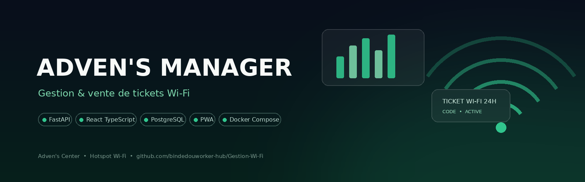
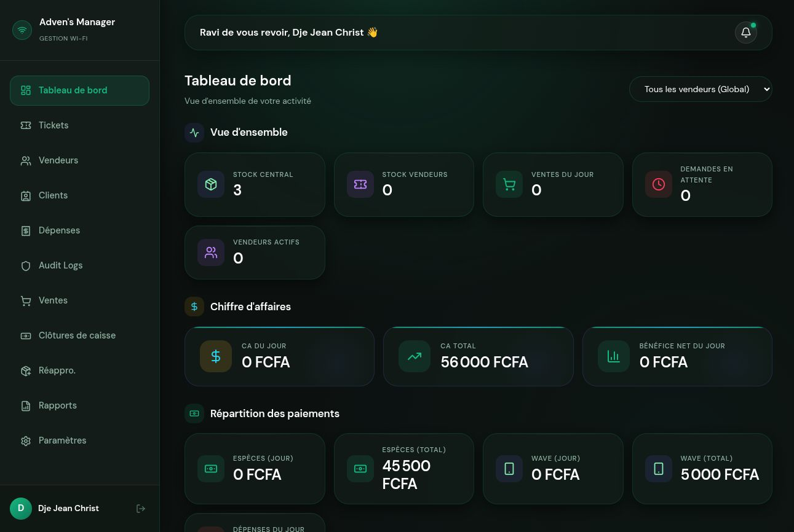
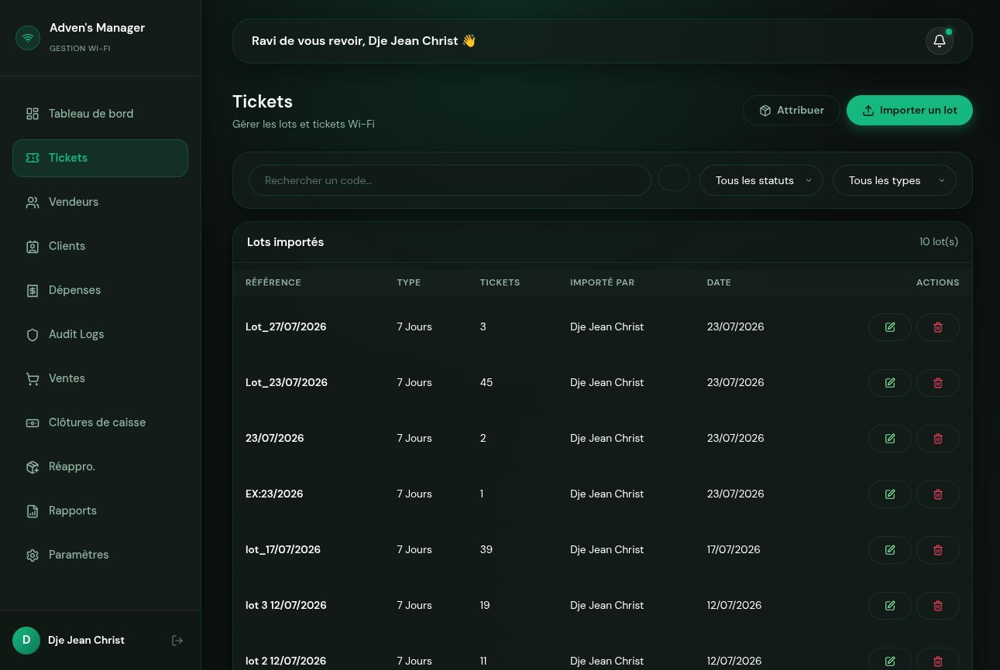
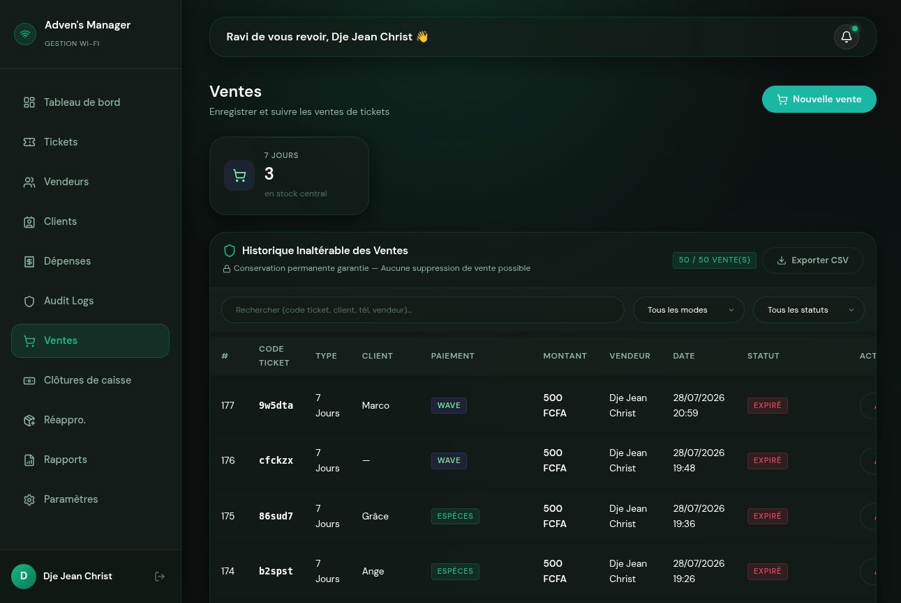
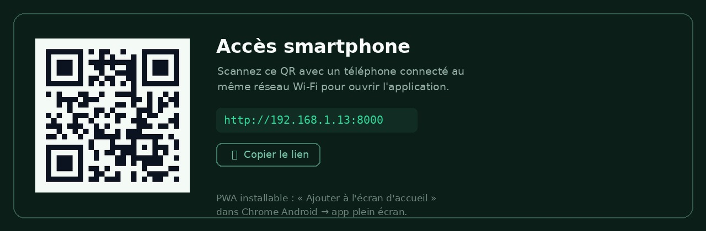

<div align="center">



**Plateforme de gestion et de vente de tickets Wi-Fi** pour Adven's Center —
FastAPI · React TypeScript · PostgreSQL · Docker

[](https://github.com/bindedouworker-hub/Gestion-Wi-Fi/actions/workflows/ci.yml)
[](LICENSE)


[Français](README.fr.md) · [English](README.md)

*Adven's Center exploite un hotspot Wi-Fi public. Les tickets sont vendus
par des vendeurs au comptoir (ordinateur) ou sur smartphone — la plateforme
couvre de bout en bout : stock de tickets, ventes, caisse et audit.*

</div>

---

## ✨ Fonctionnalités

| | |
|---|---|
|  **Stock de tickets** | Import de lots (Excel/collage), détection de doublons, attribution FIFO aux vendeurs, stock par vendeur |
|  **Caisse** | Ventes Espèces / **Wave** (QR + numéro marchand) / Crédit, remise du ticket instantanée, partage WhatsApp |
|  **Accès smartphone** | Le backend sert l'app et génère un QR code — l'équipe le scanne et obtient la PWA sur son téléphone (« Ajouter à l'écran d'accueil ») |
|  **Vraie applique Ubuntu** | `install-ubuntu.sh` transforme la stack en programmes : services systemd + fenêtre dédiée dans le dock |
|  **Sécurité d'abord** | RBAC strict, fichiers servis sous authentification, rate limiting, validation hostile-proof des uploads QR, journal d'audit complet — voir [Sécurité](#-sécurité) |
|  **Statistiques** | Tableau de bord temps réel, tendance des ventes, analyse heure par heure, rapports vendeurs, exports PDF/Excel |
|  **Exploitation** | Workflow de réapprovisionnement à valider, clôtures de caisse, historique de ventes inaltérable, backups automatisés |

## 📸 Captures d'écran

| Tableau de bord | Tickets |
|---|---|
|  |  |
| **Ventes (historique inaltérable)** | **Accès smartphone (QR)** |
|  |  |

## 🚀 Démarrage

### Option A — Docker Compose

```bash
cp backend/.env.example .env        # puis renseigner SECRET_KEY etc.
docker compose up --build
```

| Service | URL |
|---|---|
| Application (nginx) | http://localhost |
| API | http://localhost:8000 |
| Api docs (dev seulement) | http://localhost:8000/docs |

> La compose de production utilise nginx durci + Docker Secrets :
> `docker compose -f docker-compose.prod.yml up` — voir
> `docker-compose.prod.yml` et `nginx/nginx.prod.conf`.

### Option B — Développement local (sans Docker)

```bash
# Backend
cd backend
uv venv --python 3.12 .venv
uv pip install --python .venv/bin/python -r requirements.txt
cp .env.example .env                # puis renseigner SECRET_KEY etc.

# Frontend
cd ../frontend && npm install

# PostgreSQL 16 + API + Vite en une commande (Linux)
./run-local.sh                      # arrêt : ./stop-local.sh
```

| | |
|---|---|
| Application | http://localhost:5173 |
| API | http://localhost:8000 |

### Option C — Ubuntu, une commande (applique de bureau)

```bash
./install-ubuntu.sh
```

Installe tout dans `~/.local/share/advens-manager` — sans droits root —
avec des services `systemd --user`, un lanceur **Adven's Manager** dans le
menu Ubuntu (fenêtre dédiée, sans barre d'adresse), l'autostart de session
et le **QR smartphone** imprimé au démarrage + affiché dans Paramètres.
Le téléphone ouvre le même port unique :

```
http://<IP-LAN>:8000   ← scan → Ajouter à l'écran d'accueil → app
```

### Compte par défaut

| | |
|---|---|
| Utilisateur | `admin` |
| Mot de passe | `admin123` |

> ⚠️ **Changez le mot de passe immédiatement** (Paramètres ▸ *Changer mon
> mot de passe*). L'API impose au minimum 8 caractères.

## 🏗️ Architecture

```
┌──────────────┐   HTTPS    ┌───────────────┐    TCP     ┌──────────────┐
│  Frontend    │───────────▶│    Nginx      │───────────▶│  FastAPI     │
│ React + TS   │            │ TLS · CSP ·   │            │  (uvicorn)   │
│ (build PWA)  │            │ headers durcis│            └──────┬───────┘
└──────────────┘            └───────────────┘                   │
                                                          ┌────▼──────────┐
                                                          │  PostgreSQL   │
                                                          │       16      │
                                                          └───────────────┘
        smartphones ⇄ port unique :8000 (QR, LAN uniquement)
        tâches asynchrones (backups…) ⇄ Redis + Celery (compose)
```

```
.
├── backend/                # API FastAPI
│   ├── app/api/            # 12 routeurs : auth, users, tickets, sales…
│   ├── app/core/           # sécurité JWT, dépendances RBAC, rate limiting
│   ├── app/models/         # modèles SQLAlchemy
│   ├── app/schemas/        # contrats Pydantic
│   ├── app/services/       # logique métier (auth, backup, tickets…)
│   └── app/utils/          # helpers PDF / Excel / audit
├── frontend/               # React 19 + TypeScript + Vite (PWA)
│   └── src/ (components, pages, store — Zustand)
├── nginx/                  # reverse proxy (dev durci + prod TLS)
├── docs/                   # bannière & captures d'écran
├── docker-compose.yml      # stack complète (Postgres, Redis, Celery, nginx…)
├── docker-compose.prod.yml # production : Docker Secrets, nginx durci
├── install-ubuntu.sh       # installation «applique Ubuntu» en une commande
├── run-local.sh / stop-local.sh
└── LICENSE · SECURITY.md · CONTRIBUTING.md · CHANGELOG.md
```

## 🔌 Résumé de l'API

| Module | Endpoints |
|---|---|
| Auth | `POST /api/auth/login` · `POST /api/auth/change-password` · `GET /api/auth/me` |
| Users | `GET/POST /api/users/` · `PUT/DELETE /api/users/{id}` · `POST /api/users/{id}/change-password` |
| Tickets | `GET/POST /api/tickets/` · `POST /api/tickets/batches` · `POST /api/tickets/bulk-assign` · `GET /api/tickets/search?q=` |
| Sales | `GET/POST /api/sales/` · `POST /api/sales/mark-paid` · `POST /api/sales/{id}/cancel` · export CSV |
| Resupply | `GET/POST /api/resupply/` · `POST /api/resupply/{id}/process` |
| Dashboard | `GET /api/dashboard/` · `GET /api/dashboard/sales-trend` · `GET /api/dashboard/hourly-trend` |
| Reports | `POST /api/reports/generate` (PDF / Excel) |
| Settings | `GET/POST/PUT/DELETE /api/settings/payment-methods` · upload QR · backups |
| Expenses | `GET/POST /api/expenses/` *(admin uniquement)* |
| Register closures | `GET/POST /api/register-closures/` |
| Uploads | `GET /api/uploads/{path}` *(JWT requis)* |
| App access | `GET /api/app/access-url` · `GET /api/app/access-qr` |

<div align="center"></div>

## 🔒 Sécurité

Durcissement de sécurité réalisé (détails dans `SECURITY.md` et
`CHANGELOG.md`) :

- **RBAC** — rôles `ADMIN` / `TECHNICIAN` / `VENDOR` ; finances, users et
  settings exigent un *admin strict* ; les vendeurs ne voient que leurs
  données.
- **Aucun token dans les URL** — téléchargements avec en-tête
  `Authorization`.
- **Uploads authentifiés** — le `StaticFiles(/uploads)` public remplacé par
  un routeur authentifié, protégé contre la traversée.
- **Validation des uploads** — vérification des *magic bytes* réel via
  Pillow + ré-encodage PNG (SVG-XSS / polyglottes éliminés).
- **Rate limiting** — login 5/min, endpoints lourds 10/min, général
  100/min ; `429` propre.
- **Login à temps constant** — pas d'énumération d'utilisateurs.
- **Politique de mot de passe** — 8 caractères minimum imposés.
- **Recherche SQLi-proof** — échappement `%`/`_` des filtres `ILIKE`.
- **CORS en liste explicite** — origines déclarées.
- **Hygiène des secrets** — `.env` jamais commités ; `SECRET_KEY`
  vérifiée au démarrage ; Docker Secrets en production ; Redis protégé.

## 🗺️ Roadmap

- [ ] Révocation des JWT au changement de mot de passe (durée actuelle ≤ 8 h)
- [ ] Automatisation de l'expiration des tickets (à 00:00)
- [ ] Intégration vérification de solde USSD (Wave / Orange Money)
- [ ] Multi-sites (plusieurs centres)
- [ ] Notifications e-mail

## 📄 Licence

**Propriétaire — Copyright © 2026 Adven's Center.** Tous droits réservés.
Le code est publié pour la transparence et la collaboration — **ce n'est
pas un projet open-source** : toute réutilisation hors Adven's Center
nécessite une autorisation écrite. Voir [LICENSE](LICENSE) et
[SECURITY.md](SECURITY.md).

---

<div align="center">

**Développé par Mr Jackson pour Adven's Center** 🇨🇮

</div>
