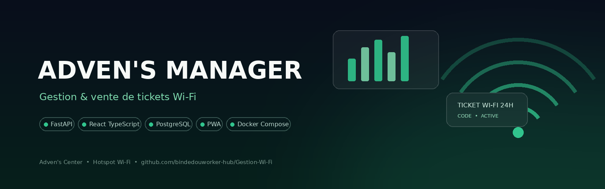
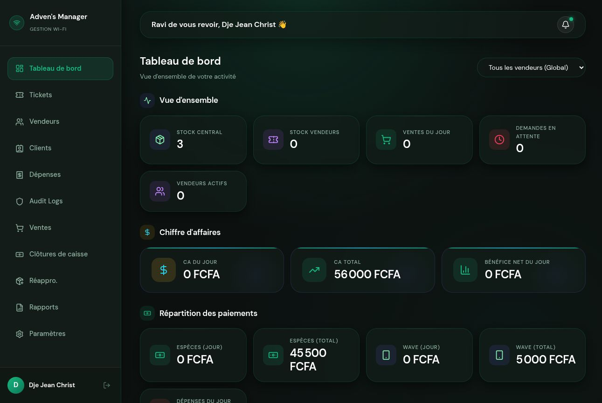
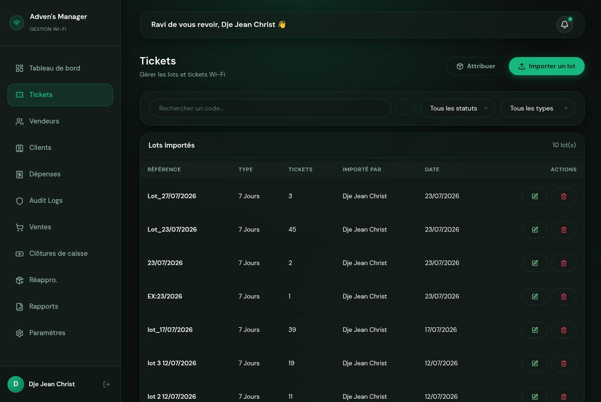
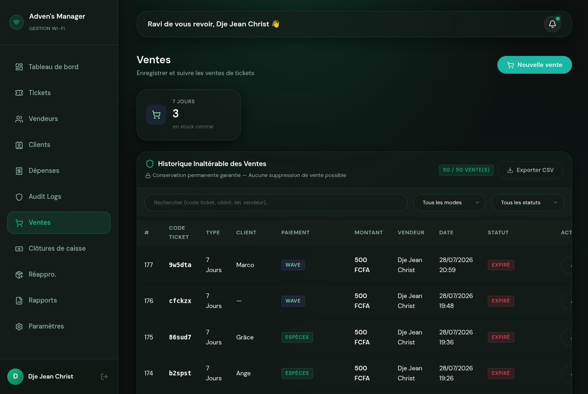
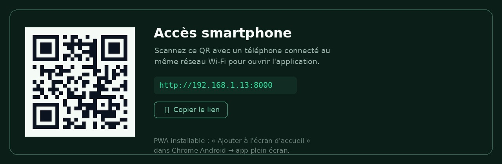

<div align="center">



**Wi-Fi ticket management & sales platform** for Adven's Center ·
FastAPI · React TypeScript · PostgreSQL · Docker

[](https://github.com/Mr-Jacks0n/Gestion-Wi-Fi/actions/workflows/ci.yml)
[](LICENSE)


[English](README.md) · [Français](README.fr.md)

*Adven's Center runs a public Wi-Fi hotspot. Tickets are sold by
laptop-installed vendors at the counter and on smartphones · this
platform covers ticket inventory, sales, cash register and audit
end-to-end.*

</div>

---

> 🎮 **Live demo (no setup)** : [interactive simulation on GitHub Pages](https://mr-jacks0n.github.io/Gestion-Wi-Fi/)
> · the full UI with fictional data, running entirely in your browser.
> For a real deployment, see [Getting started](#getting-started).

## What it does

| | |
|---|---|
| **Ticket inventory** | Import lots of Wi-Fi tickets (Excel/paste), automatic duplicate detection, FIFO assignment to vendors, per-vendor stock |
| **Point of sale** | Cash / **Wave** (QR code + merchant number) / credit sales, instant ticket delivery with WhatsApp sharing |
| **Smartphone access** | The backend serves the app and generates a QR code · staff scan it and get the PWA on their phone (« Add to home screen ») |
| **Desktop app feel** | `install-ubuntu.sh` turns the stack into real Ubuntu programs: systemd services + dedicated app window in the dock |
| **Security-first** | Strict RBAC, authenticated file uploads, rate limiting, hardened QR upload validation, full audit trail · see [Security](#-security) |
| **Insights** | Live dashboard, sales trend, hour-by-hour peak analysis, vendor performance reports, PDF/Excel exports |
| **Ops** | Resupply approval workflow, register closure summaries, immutable sales history, automated backups |

## Screenshots

| Dashboard | Tickets |
|---|---|
|  |  |
| **Sales (immutable history)** | **Smartphone access (QR)** |
|  |  |

## 🚀 Getting started

### Option A · Docker Compose

```bash
cp backend/.env.example .env        # then edit SECRET_KEY etc.
docker compose up --build
```

| Service | URL |
|---|---|
| Web app (nginx) | http://localhost |
| API | http://localhost:8000 |
| API docs (dev only) | http://localhost:8000/docs |

> The production compose uses hardened nginx + Docker Secrets:
> `docker compose -f docker-compose.prod.yml up` · see
> `docker-compose.prod.yml` and `nginx/nginx.prod.conf`.

### Option B · Local development (without Docker)

```bash
# Backend
cd backend
uv venv --python 3.12 .venv
uv pip install --python .venv/bin/python -r requirements.txt
cp .env.example .env                # then edit SECRET_KEY etc.

# Frontend
cd ../frontend && npm install

# PostgreSQL 16 + API + Vite in one command (Linux)
./run-local.sh                      # stop with ./stop-local.sh
```

| | |
|---|---|
| Web app | http://localhost:5173 |
| API | http://localhost:8000 |

### Option C · Ubuntu, one command (desktop app)

```bash
./install-ubuntu.sh
```

Installs everything to `~/.local/share/advens-manager` · no root
required · with user-level `systemd` services, a luncher in the
Ubuntu app menu (dedicated window, no browser chrome), session
autostart, and the **smartphone QR** printed at startup and shown
in Settings. The phone opens the same single port:

```
http://<your-LAN-IP>:8000   ← scan → Add to home screen → app
```

### Default account

| | |
|---|---|
| Username | `admin` |
| Password | `admin123` |

> ⚠️ **Change the password immediately** (Settings ▸ *Changer mon mot
> de passe*). The API enforces at least 8 characters.

## 🏗️ Architecture

```
┌──────────────┐   HTTPS    ┌───────────────┐    TCP     ┌──────────────┐
│  Frontend    │───────────▶│    Nginx      │───────────▶│  FastAPI     │
│ React + TS   │            │ TLS · CSP ·   │            │  (uvicorn)   │
│ (PWA build)  │            │ rate-aware    │            └──────┬───────┘
└──────────────┘            └───────────────┘                   │
                                                          ┌────▼──────────┐
                                                          │  PostgreSQL   │
                                                          │       16      │
                                                          └───────────────┘
        smartphones ⇄ single port :8000 (QR access, LAN only)
        async jobs (backups…) ⇄ Redis + Celery  (docker compose)
```

```
.
├── backend/                # FastAPI backend
│   ├── app/api/            # 12 routers: auth, users, tickets, sales…
│   ├── app/core/           # JWT security, RBAC dependencies, rate limiting
│   ├── app/models/         # SQLAlchemy models
│   ├── app/schemas/        # Pydantic contracts
│   ├── app/services/       # business logic (auth, backup, tickets…)
│   └── app/utils/          # PDF / Excel / audit helpers
├── frontend/               # React 19 + TypeScript + Vite (PWA)
│   └── src/ (components, pages, store · Zustand)
├── nginx/                  # reverse proxy configs (dev hardened + prod TLS)
├── docs/                   # banner & screenshots
├── docker-compose.yml      # full stack (Postgres, Redis, Celery, nginx…)
├── docker-compose.prod.yml # production: Docker secrets, hardened nginx
├── install-ubuntu.sh       # one-command Ubuntu desktop-app installer
├── run-local.sh / stop-local.sh
└── LICENSE · SECURITY.md · CONTRIBUTING.md · CHANGELOG.md
```

## 🔌 API overview

| Module | Endpoints |
|---|---|
| Auth | `POST /api/auth/login` · `POST /api/auth/change-password` · `GET /api/auth/me` |
| Users | `GET/POST /api/users/` · `PUT/DELETE /api/users/{id}` · `POST /api/users/{id}/change-password` |
| Tickets | `GET/POST /api/tickets/` · `POST /api/tickets/batches` · `POST /api/tickets/bulk-assign` · `GET /api/tickets/search?q=` |
| Sales | `GET/POST /api/sales/` · `POST /api/sales/mark-paid` · `POST /api/sales/{id}/cancel` · CSV export |
| Resupply | `GET/POST /api/resupply/` · `POST /api/resupply/{id}/process` |
| Dashboard | `GET /api/dashboard/` · `GET /api/dashboard/sales-trend` · `GET /api/dashboard/hourly-trend` |
| Reports | `POST /api/reports/generate` (PDF / Excel) |
| Settings | `GET/POST/PUT/DELETE /api/settings/payment-methods` · QR upload · backups |
| Expenses | `GET/POST /api/expenses/` *(admin only)* |
| Register closures | `GET/POST /api/register-closures/` |
| Uploads | `GET /api/uploads/{path}` *(JWT required)* |
| App access | `GET /api/app/access-url` · `GET /api/app/access-qr` |

<div align="center"></div>

## 🔒 Security

Completed security hardening (details in `SECURITY.md` and
`CHANGELOG.md`):

- **RBAC** · `ADMIN` / `TECHNICIAN` / `VENDOR` roles; finances, users
  and settings require *strict admin*; vendors only ever see their own
  data.
- **No token in URLs** · downloads use `Authorization` headers.
- **Authenticated uploads** · public `StaticFiles(/uploads)` replaced
  by an authenticated, traversal-safe router.
- **Upload validation** · real magic-byte checking via Pillow +
  PNG re-encoding (SVG-XSS / polyglot payloads die there).
- **Rate limiting** · login 5/min, heavy endpoints 10/min, 100/min
  general; clean `429`s.
- **Timing-safe login** · no username enumeration.
- **Passphrase policy** · 8+ characters enforced.
- **SQLi-safe search** · `%`/`_` escaping on `ILIKE` filters.
- **CORS allow-list** · explicit origins.
- **Secret hygiene** · `.env` files never committed; `SECRET_KEY`
  fail-fast boot check; Docker Secrets in production; Redis password.

## 🗺️ Roadmap

- [ ] JWT revocation on password change (token ≤ 8 h lifetime today)
- [ ] Ticket validity automation (expire tickets at 00:00)
- [ ] USSD balance check integration (Wave / Orange Money)
- [ ] Multi-center (multi-site) support
- [ ] Email notifications

## 📄 License

**Proprietary · Copyright © 2026 Adven's Center.** All rights
reserved. The source is published publicly for transparency and
collaboration · **this does not make it open-source**: reuse outside
Adven's Center requires written permission. See
[LICENSE](LICENSE) and [SECURITY.md](SECURITY.md).

---

<div align="center">

**Developed by Mr Jackson for Adven's Center** 🇨🇮

</div>
